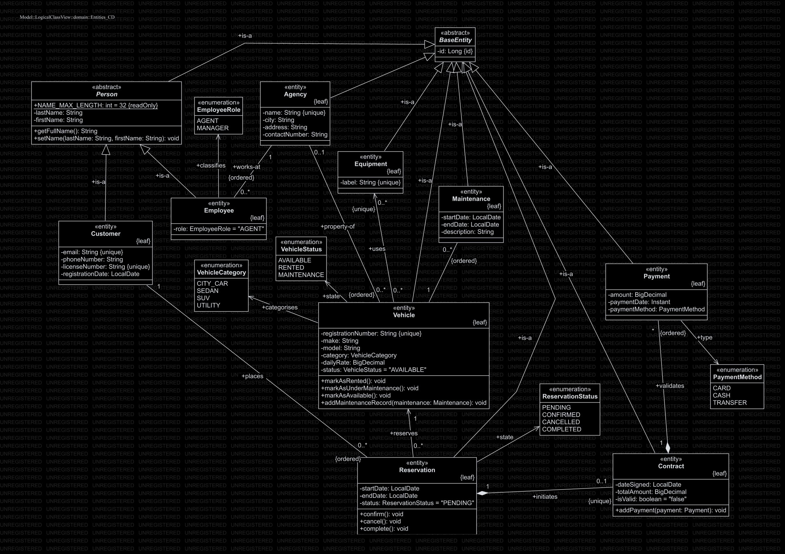

# Entity Relationships

This document describes the JPA fetch and cascade strategy currently used by the domain entities. The owning side of each relationship is the side that contains the foreign key or join table.

| Association | Cardinality | Fetch | Cascade | Strategy / reason |
| ------------- | ------------- | ------- | --------- | ------------------- |
| `Agency` -> `Vehicle` | 1 --- * | `LAZY` | None | Vehicles are associated with an agency, but can also exist without one. `Vehicle` owns the FK and should survive agency deletion. |
| `Agency` -> `Employee` | 1 --- * | `LAZY` | None | Employees are associated with an agency, but can also exist without one. `Employee` owns the FK and should survive agency deletion. |
| `Customer` -> `Reservation` | 1 --- * | `LAZY` | `PERSIST` | A `Customer` can have many reservations. `Reservation` owns the FK and is mandatory. Persisting a new reservation may cascade from the customer, while deleting or removing a customer does not delete thier reservations. |
| `Vehicle` -> `Reservation` | 1 --- * | `LAZY` | None | Vehicles can have many reservations. `Reservation` owns the FK and is mandatory. None of the reservation or vehicle lifecycle is automatically cascaded. |
| `Vehicle` -> `Maintenance` | 1 --- * | `LAZY` | `PERSIST` | Vehicles can have many maintenance records. `Maintenance` owns the FK and is mandatory. Persisting a maintenance record is allowed to cascade from the vehicle. |
| `Vehicle` <-> `Equipment` | * --- * | `LAZY` | None | Vehicles share equipment. `Vehicle` owns the join table. Both have independent lifecycles, so neither entity is automatically deleted with the other. |
| `Reservation` <-> `Contract` | 1 --- 0..1 | `LAZY` | `ALL` on reservaiton side | A contract belongs to exactly one `Reservation`. `Contract` owns the FK and is mandatory and unique. Persisting and deleting a reservation may also persist and delete its contract. |
| `Contract` -> `Payment` | 1 --- * | `LAZY` | `ALL + orphanRemoval` | Payments are made towards contracts. `Payment` owns the FK and is mandatory. Payments are persisted and removed with their contract, and removing a payment from the collection deletes it. |

## General rules

- One-to-many collections use `FetchType.LAZY` to avoid loading large related collections with their parent.
- Many-to-one and One-to-One associations use `FetchType.LAZY` to avoid fetching related entities unless they are accessed.
- Mandatory relationships should use `@JoinColumn(nullable = false)` on the owning side.
- Optional relationships use nullable entity fields and nullable join columns.
- Cascade operations are used only where one entity owns the lifecycle of another.
- Foreign-key constraints and `@JoinColumn` mappings remain the authoritative database-level protection for invalid relationships.
