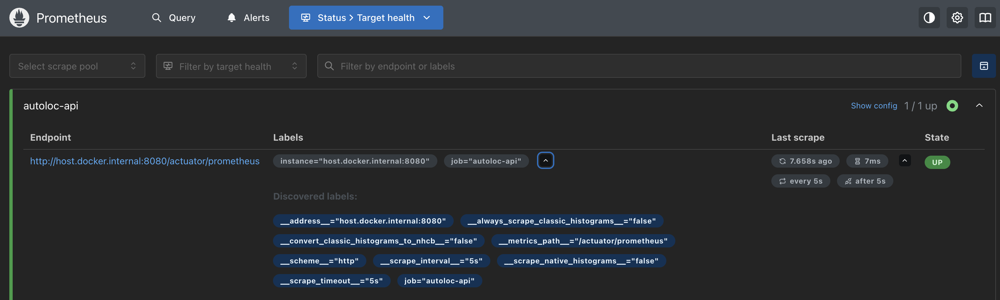
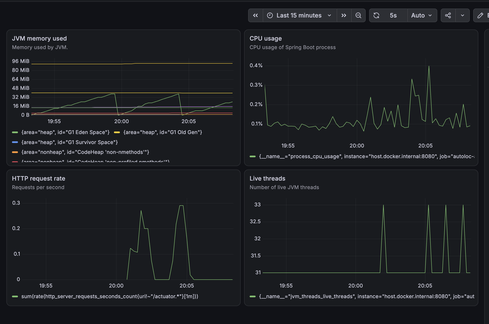

# Monitoring notes

## Architecture

The monitoring stack uses a pull-based setup defined in [`compose.yaml`](../compose.yaml) and [`prometheus.yml`](../monitoring/prometheus.yml):

1. **Spring Boot (`autoloc-api`)**: `spring-boot-starter-actuator` and `micrometer-registry-prometheus` collect application and JVM metrics and expose them at `/actuator/prometheus` (enabled in [`application.properties`](../src/main/resources/application.properties)).
2. **Prometheus (`autoloc-prometheus`, port `9090`)**: Scrapes `http://host.docker.internal:8080/actuator/prometheus` every `5s` and stores the time-series data.
3. **Grafana (`autoloc-grafana`, port `3000`)**: Queries Prometheus to visualize the metrics on the *AutoLoc - Application Monitoring* dashboard.

## Selected metrics

| Panel | Metric / Query | What it shows |
| --- | --- | --- |
| **JVM memory used** | `jvm_memory_used_bytes` (formatted in `bytes (IEC)`) | Heap (`G1 Eden Space`, `G1 Old Gen`, `G1 Survivor Space`) and non-heap (`CodeHeap`) memory usage up to ~`96 MiB`. In the 15-minute view, `G1 Eden Space` shows a sawtooth pattern—growing to ~`40 MiB` and dropping back near `0 B` during minor garbage collections. |
| **CPU usage** | `process_cpu_usage` (formatted as `%`) | CPU usage of the Spring Boot process, staying low (`0.1%`–`0.4%`) with brief spikes during simulated requests. |
| **HTTP request rate** | `sum(rate(http_server_requests_seconds_count{uri!~"/actuator.*"}[1m]))` | Application HTTP requests per second over a 1-minute window, excluding `/actuator/*` scrapes. Drops cleanly to `0` when idle and peaks around `0.3 req/s` during simulated request bursts. |
| **Live threads** | `jvm_threads_live_threads` | Active JVM threads, steady at `31` with brief spikes to `33` under load. |

## Notes and improvements

- **Filtering actuator scrapes**: Excluding `uri!~"/actuator.*"` removes Prometheus's own `5s` scrape traffic (`0.2 req/s` baseline), so idle periods accurately show `0 req/s`.
- **Unit formatting**: Using `bytes (IEC)` for memory and `%` (`Percent (0.0-1.0)`) for CPU makes trends and GC cycles easy to read across both `5m` and `15m` windows.
- **Endpoint security**: `/actuator/prometheus` is currently exposed without authentication; in production, it should be restricted to the monitoring network or protected by security rules.
